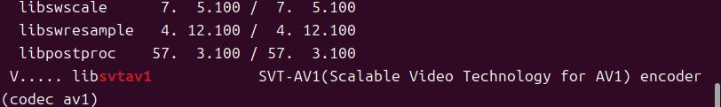
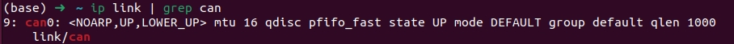
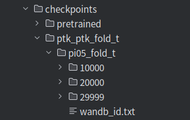

# AIRBOT PTK Dual-Arm Demo

[English](README.md) | [简体中文](README.zh-CN.md)

Dual-arm data collection, policy training, and local inference with AIRBOT Play PTK. The task-specific [cloth-folding demo](https://github.com/DISCOVER-Robotics/AIRBOT-Play-PTK-Cloth-Folding-Demo) is maintained separately.

## Resources

| Resource | Location |
| --- | --- |
| Compatible OpenPI and data-collection packages | [Official package download](https://docs.discover-robotics.com/document/assets/airbot-play/model-reproduction/pi0.5.zip) |
| PTK collection configuration | [configs/config_PTK.yaml](configs/config_PTK.yaml) |
| OpenPI training example configuration | [configs/config_ptk_example.py](configs/config_ptk_example.py) |
| Model reproduction guide | [Official documentation](https://docs.discover-robotics.com/document/airbot-play/hardware-driver/tutorials/model-reproduction/pi0.5.html) |
| Data collection guide | [Official documentation](https://docs.discover-robotics.com/document/airbot-play/hardware-driver/tutorials/data-collection.html) |
| Hardware packages | [AIRBOT Play Hardware releases](https://github.com/DISCOVER-Robotics/AIRBOT-Play-Hardware/releases) |

The implementation is in the linked compatible package, not vendored in this repository. The package contains `openpi_v0.2.0.zip` and `airbot-data-5.1.6.7.zip`. Use its AIRBOT integration rather than assuming the upstream OpenPI repository has identical scripts.

## Hardware and Software

| Component | Baseline |
| --- | --- |
| Follower arms | 2 AIRBOT Play arms |
| Teaching arms, for collection | 2 AIRBOT Replay arms |
| Cameras | Environment, left wrist, and right wrist |
| Local inference OS | Ubuntu 24.04 |
| OpenPI archive | openpi_v0.2.0 |
| Data-collection archive | airbot-data-5.1.6.7 |
| Device configuration package | airbot-configure 5.1.6-1 |
| Hardware wheel | Select the matching Python/platform wheel from the hardware releases |

Keep collection and inference environments separate when their dependency requirements differ. The official guide recommends Python 3.12 for hardware-driver installation on Ubuntu 24.04.

## Safety

These workflows can move physical robots, including during initialization and reset. Verify CAN interfaces, camera order, joint limits, and initial poses before launching. Keep the workspace clear and the emergency stop accessible. Never run a base model or a checkpoint trained for another task directly on hardware.

## 1. Prepare the Compatible Packages

Download and extract the official package, then extract its two nested archives. Enter the extracted OpenPI directory. Run installation commands there:

```bash
sudo apt install python3-venv clang ffmpeg libsvtav1-dev libturbojpeg gcc python3-dev v4l-utils
python3 -m pip install --user pipx
pipx install uv
GIT_LFS_SKIP_SMUDGE=1 uv sync
GIT_LFS_SKIP_SMUDGE=1 uv pip install -e .
```

Install the extracted data-collection project and your matching hardware wheel, replacing the paths below with actual local paths:

```bash
uv pip install -e "/path/to/airbot-data-5.1.6.7/data-collection[all]"
uv pip install /path/to/airbot_hardware_py-MATCHING_VERSION.whl
```

Install `airbot-configure_5.1.6-1_all.deb` according to the official hardware guide. Refer to the model reproduction guide for dependency troubleshooting, including `tyro==0.9.22`, `linuxpy`, and `pyturbojpeg==1.8.2`.

Verify that FFmpeg provides the SVT-AV1 encoder:

```bash
ffmpeg -encoders | grep svtav1
```



## 2. Configure Data Collection

Check that the CAN interfaces are recognized before configuring the arms. The interface names below are examples; use your actual device assignments.

```bash
ip link show
```



Use [config_PTK.yaml](configs/config_PTK.yaml) with the collection workflow documented above. Edit all four CAN interfaces and the three camera devices for your hardware. Set a new dataset ID and the actual task description before every collection run.

The collection YAML uses the LeRobot Play workflow. The OpenPI training configuration uses MCAP topics; these formats are not interchangeable. Use a collection and conversion workflow that matches your package and dataset.

## 3. Prepare the Task Configuration and Model

From the OpenPI root, create `data/ptk_example/config.py` using [config_ptk_example.py](configs/config_ptk_example.py) as a starting point. Edit task name, dataset folders, camera topics, model selection, and experiment name to match your dataset.

The example defaults to `BASE_MODEL = "pi0"`. PI0.5 requires the corresponding configuration and weights; do not switch models merely by renaming a checkpoint directory.

**This repository does not include task-specific PTK model weights.** Obtain a matching trained checkpoint and its training configuration before inference. The PI0.5 base weights at `gs://openpi-assets/checkpoints/pi05_base/params` are a training starting point, not a ready-to-run PTK task policy.

If training your own policy, run from the compatible OpenPI root:

```bash
uv run examples/airbot/compute_norm_stats.py --config-path data/ptk_example/config.py
XLA_PYTHON_CLIENT_MEM_FRACTION=0.9 uv run examples/airbot/airbot_train.py --config-path data/ptk_example/
```

Training requires a real dataset; this repository does not include one.

Checkpoint directory example. This is a reference layout, not a checkpoint included with this demo; use the output of your matching training run.



## 4. Run Dual-Arm Inference

Edit `examples/airbot/robot_config.py` in the extracted package. For its `RobotAHConfig`, check both arm interfaces, camera indices, and initial positions. Camera order must be environment, left wrist, right wrist.

Run from the OpenPI root, replacing the checkpoint path with the matching trained checkpoint:

```bash
uv run examples/airbot/airbot_inference_sync_ah.py policy-config:local-policy-config \
  --policy-config.config-path data/ptk_example \
  --policy-config.checkpoint-dir /path/to/matching/ptk/checkpoint
```

Check the inference script's prompt and reset pose against your training task before starting. Validate the configuration and motion range in a safe environment before operating on hardware.
